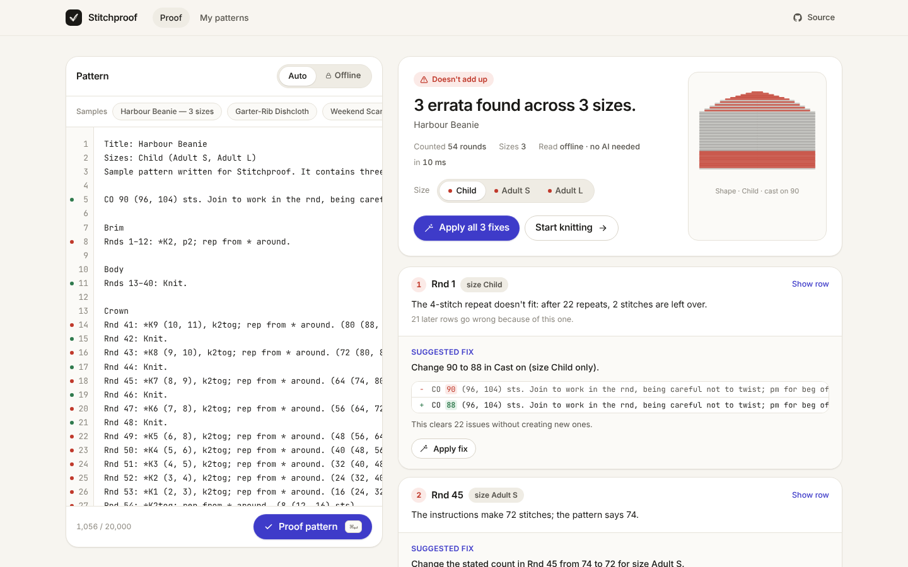
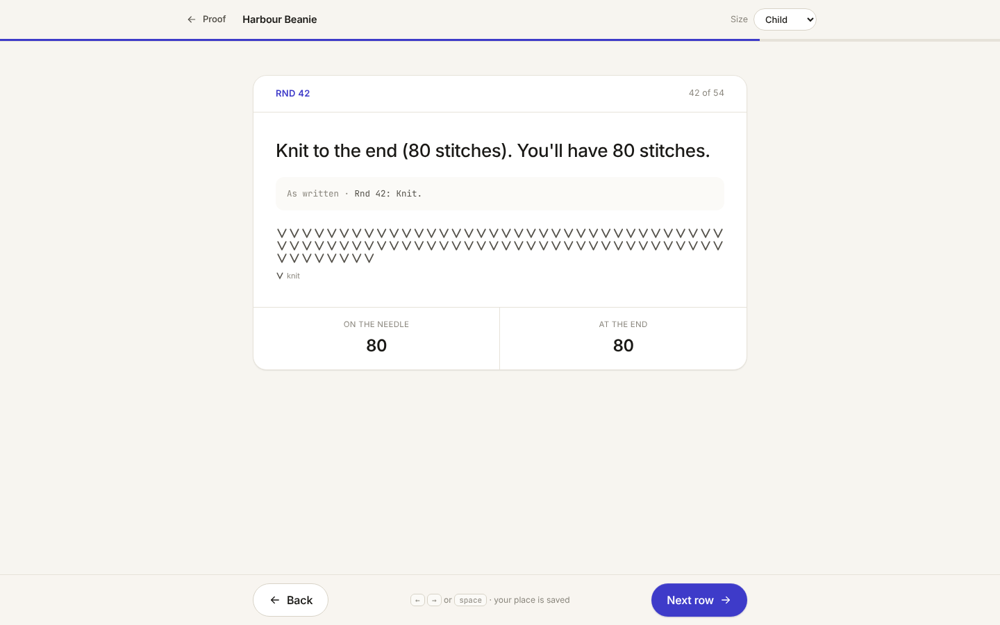
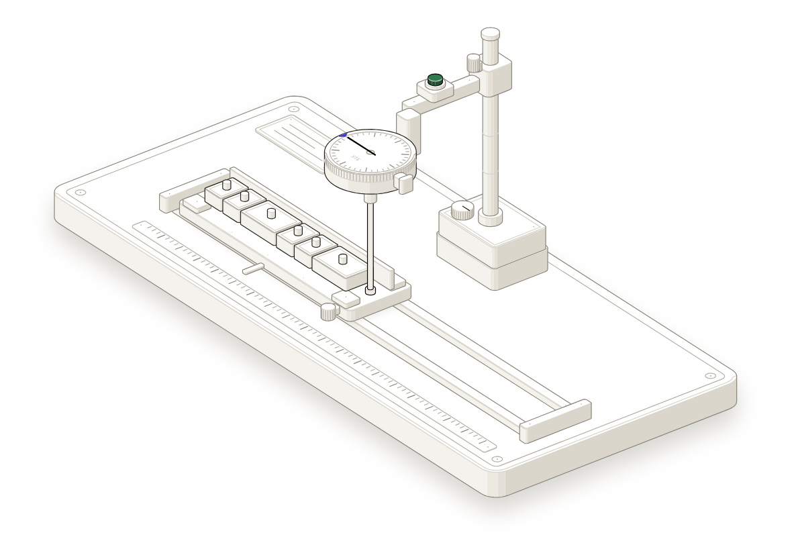
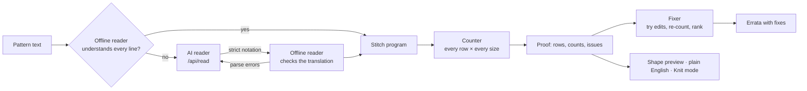
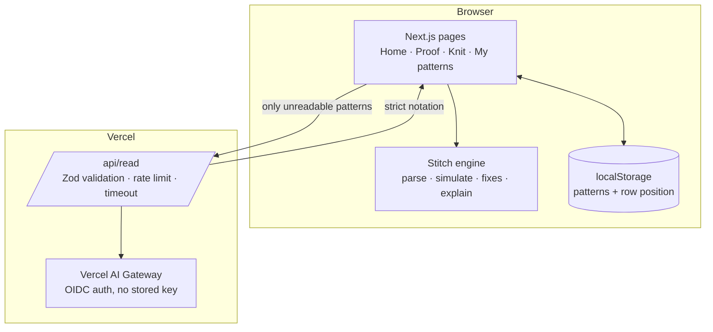

# Stitchproof

**A compiler for knitting patterns.** Paste a pattern; Stitchproof reads it, counts every stitch in every size, and shows exactly where the numbers don't add up — with the fix.

- **Live app:** https://stitchproof-alpha.vercel.app
- **Built for:** Devpost — *Build With AI: Basics* (made with the Devpost Learn Skill Pack; planning docs in [`devpost/`](devpost/))

> AI reads the words. Code counts the stitches.

---



## The problem

Every written knitting pattern makes a promise: *follow these instructions and you'll have exactly this many stitches.* Breaking that promise is expensive — you find out forty rows later and rip everything out.

- **Errata are everywhere.** Designers re-count every row of every size by hand, or pay a tech editor (typically $20–50/hour) to do it, and mistakes still ship.
- **AI-generated patterns made it worse.** Marketplaces are filling with patterns written by language models, which produce pattern-shaped text without keeping a running stitch total. Newer knitters often blame themselves when these don't work.

Stitchproof checks the arithmetic for you — without trusting a language model to do it.

## What it does

| | |
|---|---|
| **Proof** | Paste a pattern (rows or rounds, one size or many). Every row is executed for every size and compared with the count the pattern states. |
| **Root errata** | Problems are traced back to their cause — "Rnd 49 in size Adult L" — instead of a wall of red rows. |
| **Suggested fixes** | For each erratum, Stitchproof tries small edits, re-counts the whole pattern for each, and proposes the one that makes everything agree, with its evidence. One click applies it. |
| **Shape preview** | The piece's silhouette, row by row, for the selected size. |
| **Plain English** | Any row expands into words, with the repeat counts worked out ("repeat [purl 2, knit 2] until 5 stitches remain — that's 9 times"). |
| **Knit mode** | One row at a time, with the count to expect. Your place is saved in the browser. |
| **AI reader** | Messy prose ("knit every row until…") is translated by a small model into strict notation, which the parser then checks. Every number is copied, never corrected. |

<p align="center"> </p>

Try it with the samples on the Proof page: **Harbour Beanie** (three planted errata across three sizes), **Garter-Rib Dishcloth** (adds up), and **Weekend Scarf** (loose prose, read by AI). All samples are original patterns written for this project.

## How it works



**1. Read.** The offline reader (`lib/stitch/parse.ts`) turns standard notation — `CO 80 (88, 96) sts`, `*K2, p2; rep from * to last 3 sts, k3`, `Rows 3–12: Rep rows 1–2`, `(72 (81, 90) sts)` — into a *stitch program*. It records the character span of every number so fixes can edit the original text. Lines it can't read are reported, never guessed.

**2. Translate (only if needed).** If any line can't be read, the text goes to `/api/read`, which asks a small model (default `anthropic/claude-haiku-5.5` via Vercel AI Gateway) to rewrite the pattern in strict notation. The model is told to copy every number exactly — even wrong ones — so mistakes survive to be found. The output is parsed by the same offline reader; if it fails, the model is asked once more with the parser's exact errors. Anything it can't express is marked `UNSURE` and shown as "not counted".

**3. Count.** Every stitch is defined by how many stitches it **uses** and how many it **makes** (`k2tog` uses 2, makes 1; `yo` uses 0, makes 1). The counter (`lib/stitch/simulate.ts`) walks each row for each size, solves "to end" repeats as `(available − used − leave) ÷ stitches per repeat`, and flags rows where a repeat doesn't fit, stitches run out or are left unworked, or the result disagrees with the stated count.

**4. Fix.** For an issue row, the fixer (`lib/stitch/fixes.ts`) edits each number in that row (and the rows that set its count) by ±1…±3, plus the stated count itself, re-reads and re-counts the whole pattern for each candidate, and keeps the edit that leaves the fewest issues. `lib/stitch/errata.ts` repeats this to separate root causes from knock-on errors.

### System design



- **No accounts, no database.** Patterns and your place in them stay in your browser.
- **Privacy:** standard patterns never leave the browser. *Offline* mode guarantees no network call for reading.
- **Security:** request size limit (20,000 chars), Zod validation, per-instance rate limit, 40 s model timeout, security headers, no secrets in the client. On Vercel, AI Gateway authenticates with the deployment's OIDC token, so no API key is stored anywhere.

## Tech stack

Next.js 16 (App Router) · React 19 · TypeScript · Tailwind CSS 4 · AI SDK 7 + Vercel AI Gateway · Zod 4 · Vitest · Playwright · Inter, Instrument Serif and JetBrains Mono (self-hosted via Fontsource).

## Project structure

```
app/
  page.tsx              Home
  proof/page.tsx        Proof screen
  knit/[id]/page.tsx    Knit mode
  patterns/page.tsx     My patterns
  api/read/route.ts     AI reader (server)
components/             UI (ProofWorkspace, RowList, ShapePreview, StitchStrip, KnitView, CountingMachine…)
lib/
  stitch/               types, stitches, parse, simulate, fixes, errata, explain, proof
  ai/                   prompt + reader (validation and repair loop)
  samples.ts            original sample patterns
  store.ts              localStorage persistence
tests/unit/             Vitest: reader, counter, fixer, AI-reader loop
tests/e2e/              Playwright: the core journey on desktop and mobile
devpost/                scope.md, prd.md, spec.md, checklist.md, app-map.html
.agents/skills/         the Devpost Learn Skill Pack used to plan and build this
```

## Run it locally

Requires Node.js 20.9+.

```bash
npm install
npm run dev          # http://localhost:3000
```

The offline reader, counter, fixer and Knit mode work with no configuration. To use the AI reader, copy `.env.example` to `.env.local` and set **one** of:

- `GOOGLE_GENERATIVE_AI_API_KEY` — a free Google Gemini key (default model `gemini-flash-latest`, override with `GEMINI_MODEL`), or
- `AI_GATEWAY_API_KEY` — a Vercel AI Gateway key (on Vercel, the deployment's OIDC token is used automatically).

## Tests

```bash
npm test             # unit tests (Vitest)
npm run build && npm run test:e2e   # end-to-end (Playwright, desktop + mobile)
BASE_URL=https://stitchproof-alpha.vercel.app npx playwright test   # against production
```

## Deploy

Import the repository into Vercel (framework: Next.js). For the AI reader, either add `GOOGLE_GENERATIVE_AI_API_KEY`, or enable AI Gateway on the team (its OIDC token is picked up automatically; optionally set `STITCHPROOF_MODEL`).

## Notation it reads offline

| Pattern text | Meaning |
|---|---|
| `CO 80 (88, 96) sts.` | cast on, one number per size |
| `Row 3 (RS): …` / `Rnd 3: …` / `Rows 3–12: …` / `Next row: …` | rows, rounds, ranges |
| `k2, p2, k2tog, ssk, yo, m1l, m1r, kfb, sk2p, cdd, sl1, k1tbl…` | stitches |
| `*k2, p2; rep from * to end` / `to last 3 sts` / `3 more times` / `around` | star repeats |
| `[k1, p1] 5 times` / `[k1, p1] to end` | bracket repeats |
| `k to end`, `p to last 2 sts`, `Knit.` | whole/partial rows |
| `Rows 5–20: Rep rows 3–4.` / `Rep last 2 rows 4 more times.` | row repeats |
| `(72 (81, 90) sts)` / `— 72 sts` | stated counts |
| `w&t`, `work even until 6 in` | marked *can't verify* (never guessed) |

## Limitations

- Knitting only (crochet's turning-chain conventions need their own rules).
- Text only — no charts, photos or PDFs.
- Row counts that differ by size ("Rnds 13–40 (13–46, 13–52)") aren't supported yet.
- The rate limit is per server instance (best effort).

## Built with AI — disclosure

This project was planned and built with an AI coding agent (Claude) using the Devpost Learn Skill Pack, per the hackathon's rules. The planning documents in `devpost/` record which decisions were delegated. No pre-existing project code was used.

## Third-party code

- `lib/iso/iso-kit.ts` and `app/iso.css` are the isometric drawing kit from the [Anatomy](https://github.com/wheresryan22/anatomy) skill (MIT, © 2026 Ryan; license in `lib/iso/LICENSE`), used unmodified to draw Fig 1. The figure itself (`lib/figure/machine.ts`) was designed for this project.
- Fonts: Inter, Instrument Serif and JetBrains Mono via Fontsource (SIL Open Font License).

## License

[MIT](LICENSE)
